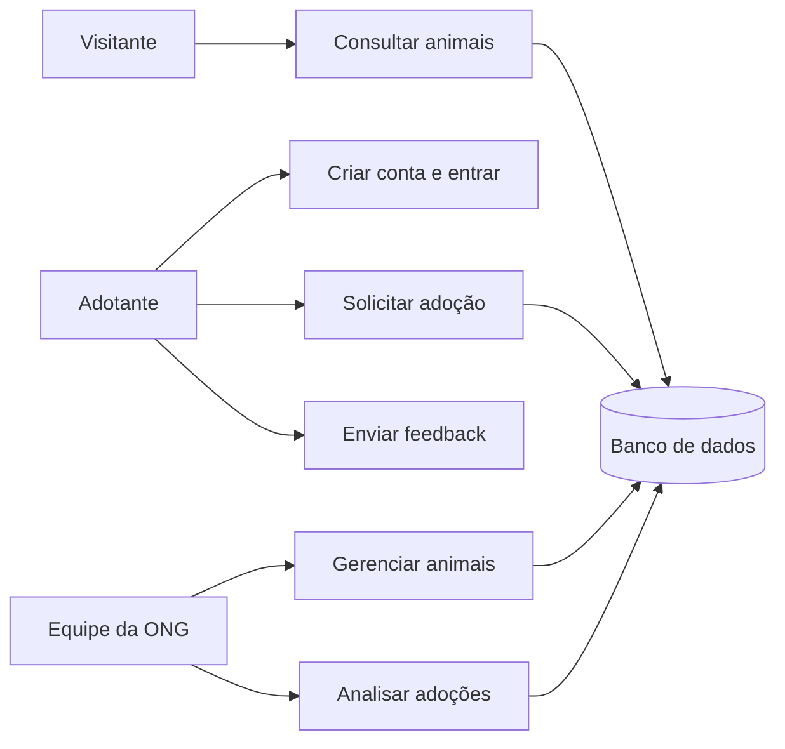
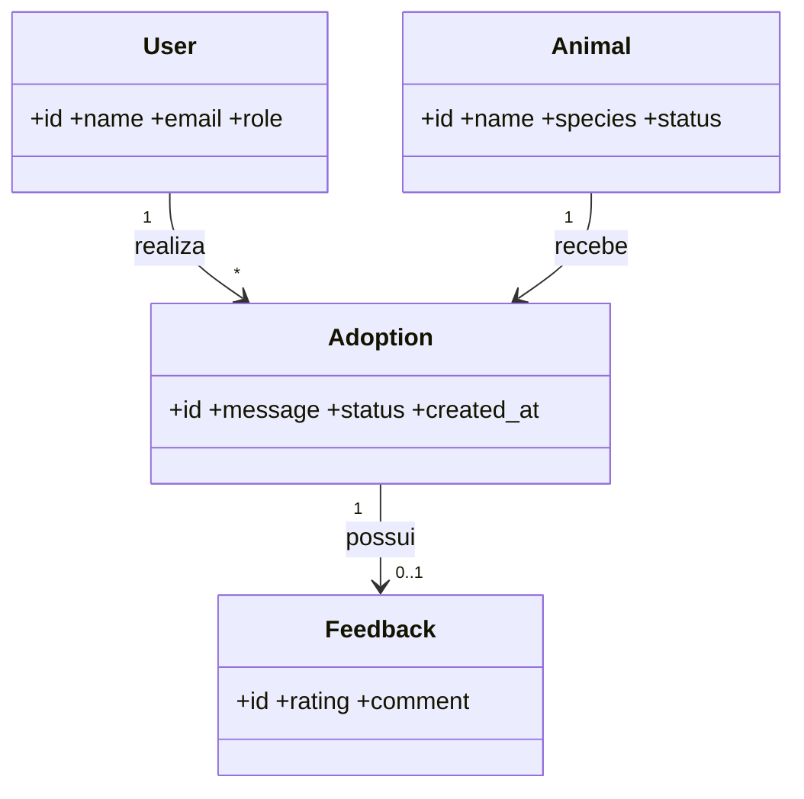

# Modelagem

## Diagrama de casos de uso

## Diagrama de classes

## Modelo relacional

`users (id, name, email, password_hash, role)`  
`animals (id, name, species, age, size, description, health, status)`  
`adoptions (id, animal_id FK, adopter_id FK, message, status)`  
`feedback (id, adoption_id FK, rating, comment)`
